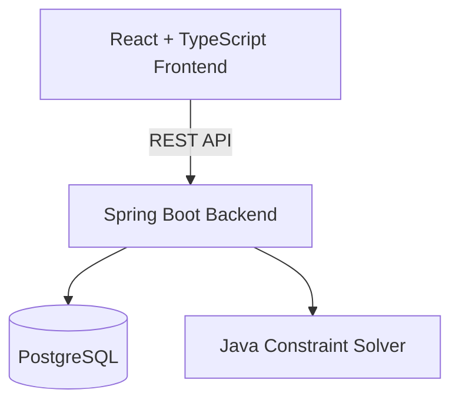

# 🎓 Smart University Scheduler

### Open-Source University Course Planner & Timetable Optimization Platform

**Build conflict-free university schedules, explore alternative timetables, and optimize your academic week with constraint-solving algorithms.**

Smart University Scheduler is an open-source full-stack application designed to help students create personalized university timetables.

Built with **React, TypeScript, Java, Spring Boot, and PostgreSQL**, the project combines practical software engineering with constraint satisfaction algorithms.

> 🚧 **Project under development.** Features described below are planned unless explicitly marked as implemented. Setup instructions and availability may change.

## ✨ Planned Features

- 📚 **Course Management** — Browse courses, lectures, and laboratory sections.
- 📅 **Interactive Timetable** — Visualize your weekly academic schedule.
- 🧠 **Constraint Solver** — Generate schedules using Backtracking, MRV, and Forward Checking.
- ⚡ **Conflict Detection** — Identify overlapping lectures and laboratories.
- 🎯 **Preference Optimization** — Minimize gaps, campus days, and unwanted time slots.
- 🏆 **Top 5 Schedules** — Compare ranked timetable alternatives.
- 💾 **Save & Export** — Save schedules and export calendar events.
- 🔐 **Authentication** — Secure student and administrator access.

## 🛠️ Technology Stack

| Layer | Technology |
| --- | --- |
| Frontend | React, TypeScript, Vite |
| Backend | Java 21, Spring Boot |
| Database | PostgreSQL |
| Optimization | Custom Java CSP Solver |
| Security | Spring Security |
| Infrastructure | Docker Compose |
| Testing (planned) | JUnit, Testcontainers, Vitest, Playwright |
| CI/CD (planned) | GitHub Actions |

## 📖 Table of Contents

- [Why This Project?](#why-this-project)
- [Planned Features](#-planned-features)
- [Technology Stack](#️-technology-stack)
- [Getting Started](#-getting-started)
- [Architecture](#️-architecture)
- [Constraint Solver](#-constraint-solver)
- [Developer Learning Path](#-developer-learning-path)
- [Project Roadmap](#️-project-roadmap)
- [Contributing](#-contributing)
- [License](#-license)

## Why This Project?

University students often struggle to create weekly schedules because courses have multiple sections, conflicting time slots, and different attendance requirements.

This project aims to make academic planning simpler while serving as a practical open-source reference for full-stack development and scheduling algorithms.

## 🚀 Getting Started

The following commands are intended for use **after the Docker environment is implemented and verified**:

```bash
git clone https://github.com/hkokk1234/smart-university-scheduler.git
cd smart-university-scheduler
cp .env.example .env
docker compose up --build
```

Configure the required environment variables before starting. On Windows PowerShell, use `Copy-Item .env.example .env` instead of `cp` if preferred.

> **Note:** The repository URL and setup commands have not been verified against a live deployment. Check the repository contents and `compose.yaml` before running them.

## 🏗️ Architecture

The project is designed as a **modular monolith**:



Core components:

- React frontend
- Spring Boot REST API
- PostgreSQL database
- Independent constraint-solving module

Detailed diagrams and design decisions will be maintained in `docs/`.

## 🧠 Constraint Solver

The scheduling engine will model timetable generation as a **Constraint Satisfaction Problem (CSP)**.

**Hard constraints:** No overlapping classes, valid section selections, and mandatory availability rules.

**Soft constraints:** Preferred hours, fewer campus days, and minimized gaps.

The planned solver will use **Backtracking**, **Minimum Remaining Values (MRV)**, and **Forward Checking** to generate and rank valid timetable options.

## 🎓 Developer Learning Path

This project is also intended as a practical learning resource.

- [ ] Understand university scheduling requirements
- [ ] Design a relational database
- [ ] Build RESTful APIs with Spring Boot
- [ ] Create a React scheduling interface
- [ ] Implement conflict detection
- [ ] Implement a CSP solver
- [ ] Add preference-based optimization
- [ ] Write automated tests
- [ ] Containerize the application
- [ ] Deploy and monitor the system

## 🗺️ Project Roadmap

- [ ] **Phase 1** — Project foundation
- [ ] **Phase 2** — Authentication and course catalog
- [ ] **Phase 3** — Interactive timetable
- [ ] **Phase 4** — Constraint solver
- [ ] **Phase 5** — Optimization and schedule persistence
- [ ] **Phase 6** — Testing and deployment

## 🤝 Contributing

Contributions, bug reports, documentation improvements, and feature suggestions are welcome.

Development guidelines will be documented in `CONTRIBUTING.md` when available.

## 📄 License

An open-source license will be selected and added before the public release. Until then, do not assume the repository is licensed for reuse or redistribution.
