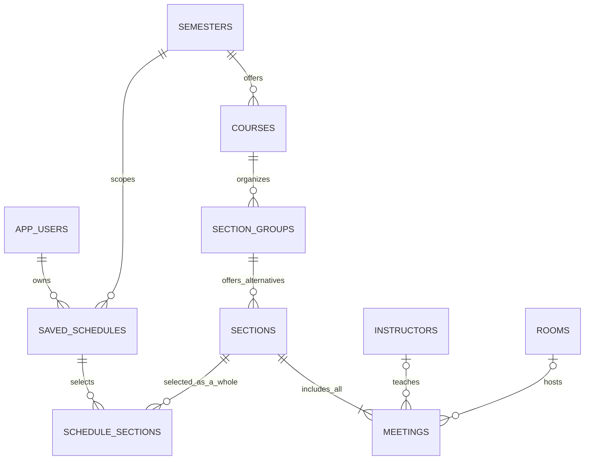

# Scheduler database

PostgreSQL 17 is the reference database. Flyway owns the schema; Spring Data JPA maps it
with `ddl-auto=validate`. The existing V1 migration is unchanged. Every entity has a UUID
primary key: Hibernate generates UUIDs for JPA inserts, and SQL inserts can use the
database's `gen_random_uuid()` default. No PostgreSQL extension is required.

## Relationships



## Tables

| Entity / table | Data and key rules |
| --- | --- |
| `User` / `app_users` | Normalized, unique email; display name; creation timestamp; nullable BCrypt password hash; role constrained to STUDENT/ADMIN, default STUDENT. Demo users with null hashes cannot log in. |
| `Semester` / `semesters` | Unique code, name, start/end dates, IANA time-zone identifier. Start precedes end. |
| `Course` / `courses` | Semester, code, title, numeric credits. `(semester_id, code)` is unique; credits are positive and at most 60, with one decimal place. |
| `SectionGroup` / `section_groups` | Course, semester, code, name, type. `(course_id, code)` is unique. Types: `LECTURE`, `LABORATORY`, `TUTORIAL`, `SEMINAR`. |
| `Section` / `sections` | Group, semester, alternative code, positive capacity, nonnegative optimistic-lock version. `(section_group_id, code)` is unique. At least one meeting at transaction commit. |
| `Meeting` / `meetings` | Section, ISO weekday, local start/end times, optional instructor and room. Exact duplicate `(section_id, weekday, start_time, end_time)` slots are prohibited. |
| `Instructor` / `instructors` | Unique staff code, display name, optional normalized unique email. One instructor per meeting; different meetings can have different instructors. |
| `Room` / `rooms` | Building, code, positive capacity. `(building, code)` is unique. A missing meeting room means location is not assigned yet. |
| `SavedSchedule` / `saved_schedules` | Owner, semester, name, creation timestamp. `(user_id, semester_id, name)` is unique. Draft schedules may contain no selections. |
| `ScheduleSection` / `schedule_sections` | UUID join entity linking a saved schedule to an entire section. `(saved_schedule_id, section_group_id)` is unique. |

Required text columns reject blank strings. Code and schedule-name uniqueness is case
sensitive. Email is stored lowercase and trimmed; raw SQL with unnormalized email is rejected.
Creation timestamps are `TIMESTAMPTZ` and mapped to Java `Instant`.

## Meeting and selection rules

- Weekdays use ISO numbering: Monday `1` through Sunday `7`. Java uses `DayOfWeek`
  through an explicit JPA converter; ordinal enum persistence is not used.
- Meeting times are `TIME WITHOUT TIME ZONE`, interpreted in the semester's time zone.
  `start_time < end_time` and `end_time < 24:00:00` are checked in PostgreSQL. Overnight
  meetings must be represented as separate same-day occurrences. JPA uses `LocalTime`.
  Semester constructors validate time-zone names using Java `ZoneId`; SQL stores a
  nonblank identifier and direct SQL importers must provide a valid IANA identifier.
- Choosing a section selects every meeting. There is no schedule-to-meeting join table
  and no facility to select a subset of a section's meetings.
- A saved schedule belongs to exactly one semester. Only one alternative can be chosen
  from each group, while a lecture and a laboratory group for the same course may both
  be selected. Selecting every group for a course is not required for a draft schedule.
- Conflict detection and scheduling optimization are implemented in the independent
  [CSP solver](solver.md). Enrollment counts, room/section capacity matching and holidays
  remain application concerns; they are not database constraints.

## Database integrity across semesters

`semester_id` is deliberately propagated into section groups, sections, and selections.
`section_group_id` is also stored on selections. Composite foreign keys enforce:

| Child columns | Referenced parent columns |
| --- | --- |
| `section_groups(course_id, semester_id)` | `courses(id, semester_id)` |
| `sections(section_group_id, semester_id)` | `section_groups(id, semester_id)` |
| `schedule_sections(saved_schedule_id, semester_id)` | `saved_schedules(id, semester_id)` |
| `schedule_sections(section_id, section_group_id, semester_id)` | `sections(id, section_group_id, semester_id)` |

These columns cannot disagree, including when rows are written directly through SQL.
The corresponding composite unique parent keys are required by PostgreSQL for these
references. JPA maps the associations by their UUID identifiers and derives the redundant
fields from the parent in constructors; Flyway defines the stronger composite foreign keys.
Parent associations have no public setters.

## At least one meeting per section

Two deferred constraint triggers share `enforce_section_has_meeting()`. They run after
section insertion/update and meeting deletion/reassignment, and check the final state
at transaction commit. The parent section is locked before checking, serializing
concurrent attempts to delete its remaining meetings under the default READ COMMITTED
isolation level. A violation uses SQLSTATE `23514` and constraint name
`ck_section_has_meeting`.

Create a section and all of its meetings in one transaction. JPA's `Section.addMeeting()`
maintains both sides of the association; persisting the section cascades persistence to
its meetings. Removing a meeting uses orphan removal. Removing the last meeting causes
commit to fail unless a replacement is added within that same transaction. Deleting an
unselected section also deletes its meetings; the trigger permits this because the parent
no longer exists. Do not bypass these checks with `TRUNCATE`, disabled triggers, or
administrative bulk operations in application code.

## Indexes and deletion

Primary keys and unique constraints create indexes automatically. Leading columns of
natural-key indexes support course-by-semester, group-by-course, section-by-group,
meeting-by-section, schedule-by-user, and selection-by-schedule queries. Additional
indexes support semester filtering on groups/sections/schedules and selection lookup
by section. Partial indexes cover assigned instructor and room foreign keys.

Catalog parent foreign keys use `RESTRICT`: referenced semesters, courses, groups,
instructors, rooms, and selected sections cannot be silently removed. Deleting a section
cascades to its meetings. Deleting a saved schedule cascades only to its selections.
Deleting a user cascades to their saved schedules and selections, while catalog data
remains intact. There are no JPA remove cascades from child entities to catalog parents.

## Java boundaries and DTOs

- `identity`: user entity, repository, DTO, and mapper.
- `catalog`: semester, course, group, section, meeting, instructor, and room entities,
  repositories, DTOs, and a transactional section read service.
- `scheduling`: saved schedule and selection entities, repositories, DTOs, and an
  owner-scoped transactional schedule read service.
- `platform/persistence`: shared UUID mapping and basic value validation.

Every entity has an immutable record DTO. Section DTOs include all meetings; saved
schedule DTOs include selected sections and their full meeting lists. Relationships
are represented by UUIDs or nested DTOs, never entity objects. Collection DTOs copy
their lists. Entity graphs fetch the required relationships, and mapping happens inside
read transactions before returning DTOs, so JSON serialization works with Open Session
in View disabled. REST controllers use these DTOs and obtain schedule ownership from
the authenticated JWT principal. See [API documentation](api.md).

## Migrations and demonstration data

| Migration | Location | Purpose |
| --- | --- | --- |
| V1 | `db/migration` | Existing infrastructure baseline, unchanged |
| V2 | `db/migration` | All ten tables, constraints, indexes, and triggers |
| V2.1 | `db/demo` | Fictional Helios University, Autumn 2026 |
| V3 | `db/migration` | Password hashes, roles, and section optimistic-lock version |

The default profile scans only `db/migration`. The `dev` profile also scans `db/demo`.
The demo version precedes V3, so development databases can evolve
without enabling out-of-order migrations. Demo inserts are transactional and use fixed
UUIDs; Flyway runs them once rather than silently overwriting existing records.

The semester runs from September 21, 2026 to January 29, 2027 in `Europe/Athens` and has
two students, three instructors, three rooms, three courses (`CS101`, `CS205`, `MATH201`),
five lecture/laboratory groups, ten alternative sections, sixteen weekly meetings, and
one saved schedule with five selected sections and eight meetings. `example.edu` email
addresses and people are demonstration values, not real university records. Alternatives
include both compatible and conflicting combinations for future scheduling work.

Run development against the existing local Compose database:

```sh
docker compose up -d --wait postgres
cd backend
./mvnw spring-boot:run -Dspring-boot.run.profiles=dev
```

On PowerShell use `./mvnw.cmd spring-boot:run '-Dspring-boot.run.profiles=dev'`.
An existing V1 database upgrades automatically. Keep development and production
databases separate. Changing profiles does not remove demonstration data or its migration
history. Continue including the demo migration location for a development database;
excluding an applied migration can cause Flyway validation failures as versions evolve.
If real data
already uses the demonstration natural keys, use a separate demo database instead of
changing an applied migration or suppressing conflicts.

## Integration tests

```sh
cd backend
./mvnw verify -Pintegration
```

Use `./mvnw.cmd` on Windows. Docker must be available; no `.env`, local database, or
Compose startup is required for tests. Testcontainers starts a fresh PostgreSQL 17
container on a random mapped port and supplies datasource properties dynamically.
The container is not reused and is removed after the tests.

The suite verifies main plus demonstration migrations on the clean container database,
production-only migrations on a second clean database, migration reruns, Hibernate
schema validation, all entity/repository mappings, detached DTO serialization,
ownership filtering, weekday/time checks, natural-key uniqueness, composite foreign
keys, duplicate alternatives, deferred minimum-meeting checks, concurrent meeting
deletion, and deletion/cascade behavior. The existing security tests remain independent
of database availability. CI uses the same Testcontainers suite.

References: [Testcontainers PostgreSQL databases](https://java.testcontainers.org/modules/databases/)
and [JUnit integration](https://java.testcontainers.org/quickstart/junit_5_quickstart/).
